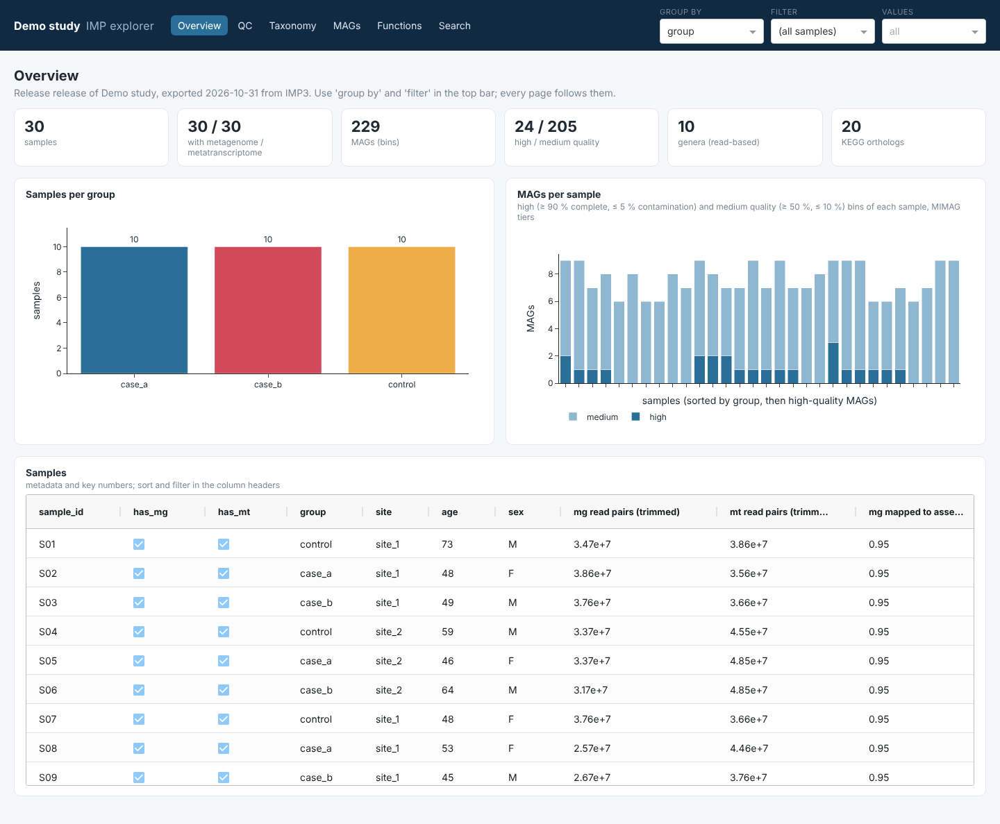
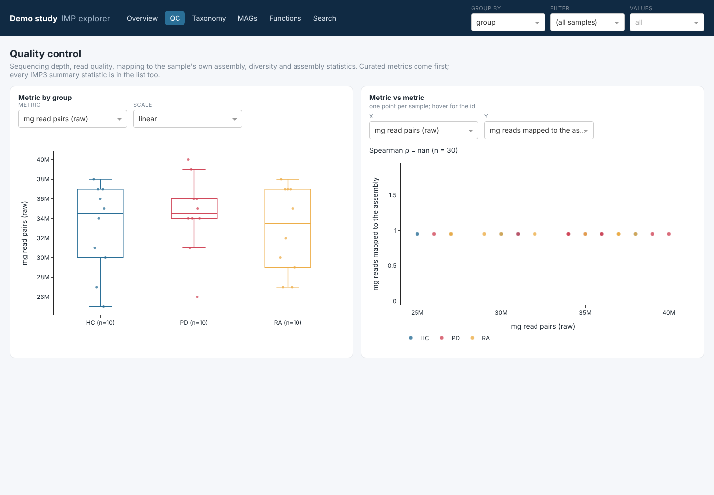
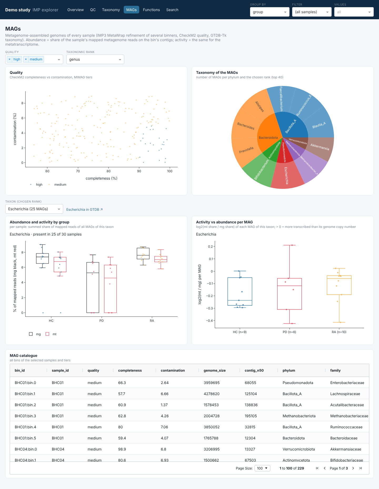
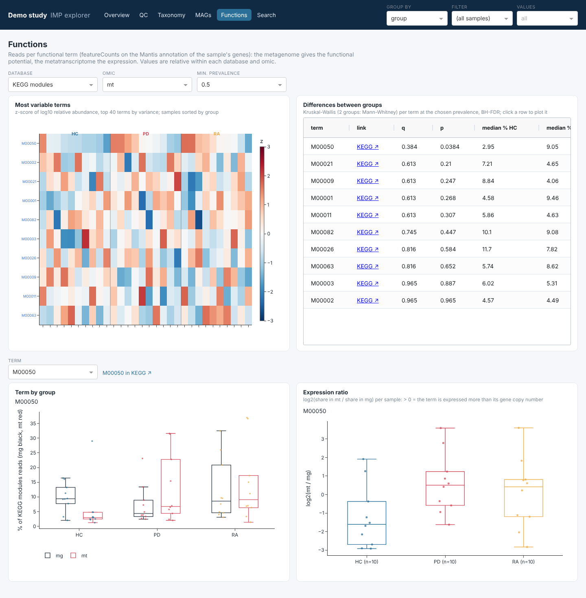
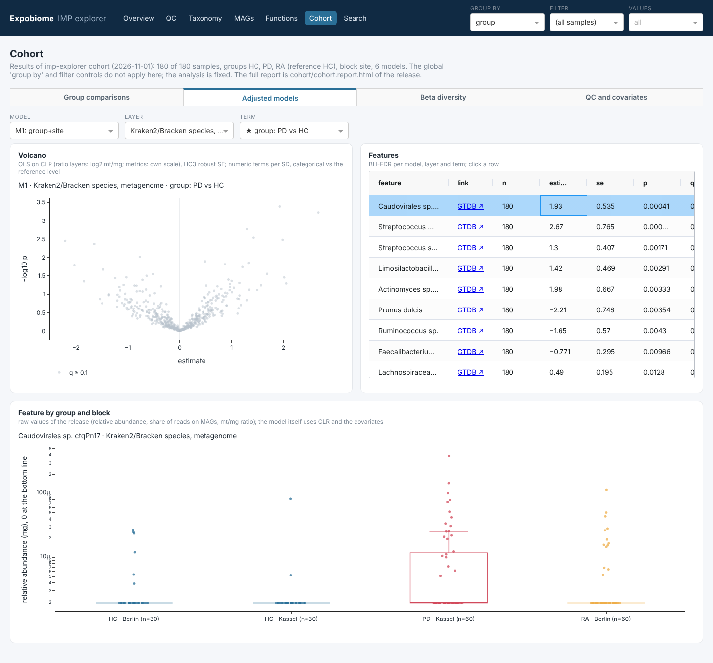

# The app

The top bar holds three controls that every page follows:

- **group by**: any metadata column with 2–12 values (default `group` if present). Colours, box plots, group tests
  and PERMANOVA use it.
- **filter** / **values**: keep only samples with the chosen values of one column, e.g. `site = site_1` to compare
  groups within one site.

Tables can be sorted and filtered in their column headers; clicking a row of a group-test table plots that feature.
Plots can be zoomed, and saved as SVG with the camera icon. Feature ids link to their reference page (KEGG, CAZy,
GTDB).

## Overview

Samples per group, MAGs per sample (MIMAG tiers) and a table of all samples with their metadata and key numbers
(trimmed read pairs, mapping to the assembly, assembly N50, Nonpareil diversity, high- and medium-quality MAGs).

With [sRNA results](srna.md) imported, a second row of numbers shows the sRNA samples (and how many are in the
release), the libraries per fraction, human miRNAs and genera detected, and the sRNA features with q below the
threshold in a group comparison; the sample table gets one column per sRNA fraction.

## QC

Any QC metric by group, and any two metrics against each other (Spearman ρ). The curated metrics come first
(read pairs, Q30, mapping to the assembly, Nonpareil, assembly size and N50, number of bins); every statistic of
IMP3's `Stats/all_stats.tsv` is listed after them (prefix `imp:`).

## Taxonomy

Choose a profile: Kraken2/Bracken per rank (with the Kraken2 database set in the IMP3 config, NCBI or GTDB) or mOTUs, for the metagenome or the metatranscriptome.

- **Composition**: stacked bars of the top taxa, samples sorted by group and then by the most abundant taxon.
  As a **heatmap**: z-scores of the most variable taxa (in ≥ 10 % of the samples), see
  [clustered heatmaps](#clustered-heatmaps).
- **Beta diversity**: Bray-Curtis PCoA of the relative abundances; PERMANOVA (499 permutations) by the grouping.
- **Differences between groups**: Kruskal-Wallis (two groups: Mann-Whitney) per taxon present in ≥ 10 % of the
  samples, Benjamini-Hochberg q, group medians in %.
- **One taxon**: by group (log scale; samples without the taxon at the bottom line) and metagenome vs
  metatranscriptome abundance per sample: points above the diagonal are more active than abundant.

## MAGs

The MAGs of all samples (IMP3: several binners refined by MetaWrap, CheckM2 quality, GTDB-Tk taxonomy).

- **Quality**: completeness vs contamination, coloured by MIMAG tier (high ≥ 90 % / ≤ 5 %, medium ≥ 50 % / ≤ 10 %).
- **Taxonomy of the MAGs**: MAGs per phylum and chosen rank.
- **Abundance and activity**: for one taxon, the summed share of mapped metagenome and metatranscriptome reads on its
  MAGs in each sample, by group; samples without such a MAG count as 0.
- **Activity vs abundance per MAG**: log2(mt share / mg share) of each MAG; > 0 means more transcription than the
  genome's copy number suggests.
- **MAG catalogue**: all bins with quality, size, N50, taxonomy and closest reference genome.

## Functions

Reads per functional term from featureCounts on IMP3's Mantis annotation, relative within database and omic.

- **Most variable terms**: heatmap of the 40 most variable terms, see [clustered heatmaps](#clustered-heatmaps);
  term ids link to KEGG.
- **Differences between groups**: as for taxonomy, at the chosen minimum prevalence; a link column opens KEGG / CAZy.
- **One term**: metagenome and metatranscriptome share by group, and the expression ratio log2(mt / mg) per sample.

### Clustered heatmaps

The heatmaps of the Functions page and of the taxonomy composition have four controls:

| control | options |
|---|---|
| rows | by variance, or **clustered**: average linkage on correlation distance, optimal leaf order, dendrogram on the left; features that rise and fall together end up next to each other |
| samples | by group then the top feature; **clustered within group** (the group blocks stay); **clustered (all samples)**, Euclidean distance, dendrogram on top: do the samples sort by group, by site or by something else? |
| values | z of log10 relative abundance, or z of **CLR** (log-ratio to the sample's mean feature; the better basis for compositional data) |
| colour bar | a second metadata column shown above the heatmap next to the group bar, e.g. site |

z-scores are per feature over the selected samples, so the top-bar filter changes them. Hierarchical clustering always
gives a tree, also from noise: check blocks against the group tests, the ordination and the cohort analysis.

## Search

Type part of a name: a taxon at any rank (Kraken2, mOTUs, GTDB names of the MAGs) or a functional id (KO, module,
pathway, CAZyme, EC). Picking a hit plots it in every layer where it occurs, side by side by group, e.g. a genus in
Kraken2 mg and mt, mOTUs mg and mt, and the MAGs mg and mt.

## sRNA

Shown when the release contains sRNA results ([`imp-explorer srna`](srna.md)): composition of any sRNA feature set,
library QC, RNA classes by group, and one feature next to the metagenome and metatranscriptome of the same samples.

## Proteomics

Shown when the release contains metaproteomics ([`imp-explorer proteomics`](proteomics.md)): library QC by group,
the genera behind the protein abundance of a KEGG term, a genus's main KEGG terms, and the proteins of a term. The
protein profiles are also omics `mp_<fraction>` on the Taxonomy page (with an *Across omics* panel: one taxon in mg,
mt and the protein fractions) and on the Functions page (a term in mg, mt and the protein fractions).

## Metabolomics

Shown when the release contains metabolomics results ([`imp-explorer metabolomics`](metabolomics.md)): profiles of
each assay (clustered heatmap; all features or identified only), one feature by group in the units of the assay, its
Spearman correlation with the taxa or functions of the IMP3 profiles, and a table of all features. With metabolomics
imported, the Overview shows a row of key numbers and one column per assay in the sample table, and Search finds
metabolites.

## Cohort

Shown when the release contains the results of [`imp-explorer cohort`](cohort.md) and / or of the sRNA-IMP cohort
analysis ([`imp-explorer srna`](srna.md)); the sRNA layers appear next to the IMP3 layers. The results are fixed: the global
'group by' and filter controls do not apply.

- **Group comparisons**: per layer and comparison (each group vs the reference within shared blocks, the block
  contrast in the reference group, Kruskal-Wallis across groups), a volcano and the feature table. Clicking a row plots
  the feature by group and block.
- **Adjusted models**: per model (with its question), layer and term (★ = term of interest), a volcano of the
  estimates and the feature table, with design notes. The plot shows the raw values; the model itself uses CLR and the
  covariates.
- **Beta diversity**: PCoA or NMDS of a layer by group and block, PERMANOVA and dispersion.
- **QC and covariates**: covariate balance, metric tests, any metric by group and block, QC flags.

## Statistics: what they are and are not

The tests of the other pages are exploratory: one non-parametric test per feature with BH correction, no covariates,
on the samples and grouping chosen in the top bar. Covariate-adjusted models and comparisons within blocks come from
the [cohort analysis](cohort.md). Relative abundances are compositional; group differences in one taxon can come from
changes in others.
