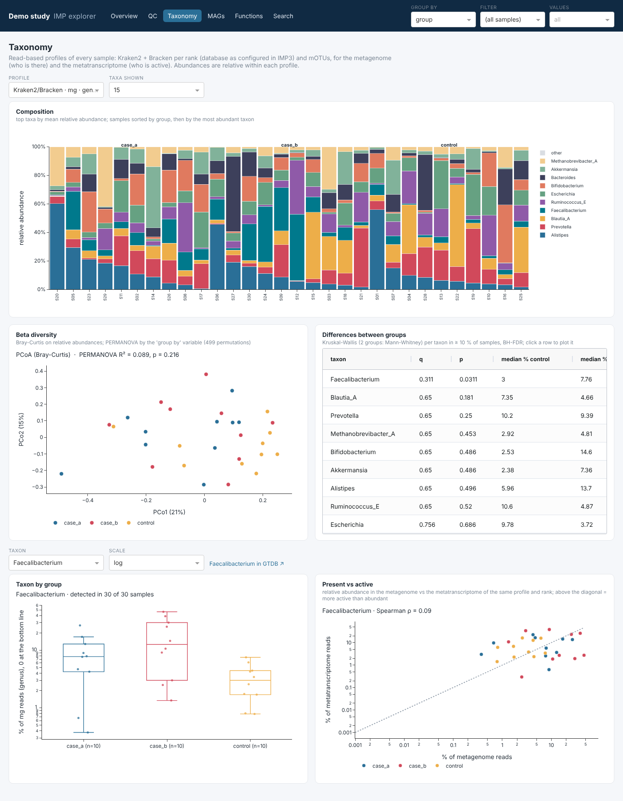
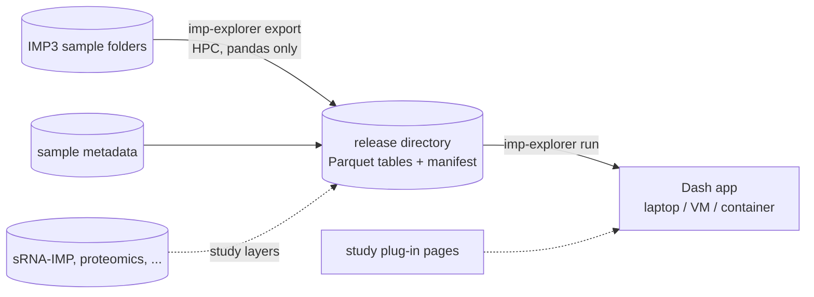

# IMP explorer

IMP explorer turns the results of [IMP3](https://github.com/genomeanalysislcsb/IMP3) (integrated metagenomics and
metatranscriptomics) for a whole study into an interactive web app: QC, read-based taxonomy, MAGs, functions and a
search across all of them, by group and site.



It works in two steps:



1. **export** reads the IMP3 output folder of every sample and writes one *release*: six long-format tables with shared
   keys (sample, omic, feature) plus a manifest. It needs only pandas and runs where the data are.
2. **run** starts the app on a release. The release is small (tens to a few hundred MB for ~200 samples), so the app
   runs on a laptop, a VM or in a container.

The app is the core of study portals: a study adds its own layers (sRNA from [sRNA-IMP](https://github.com/genomeanalysislcsb/sRNA-IMP),
proteomics, metabolomics, immune data) as extra tables and pages, without changing the IMP core
([plug-ins](plugins.md)).

| page | question it answers |
|---|---|
| [Overview](app.md#overview) | what is in the study, how many samples, MAGs, features |
| [QC](app.md#qc) | are depth, quality, mapping and assembly comparable between groups? |
| [Taxonomy](app.md#taxonomy) | who is there (metagenome) and who is active (metatranscriptome)? |
| [MAGs](app.md#mags) | which genomes were recovered, how abundant and how active are they? |
| [Functions](app.md#functions) | which KEGG / CAZy / EC functions differ, and are they expressed? |
| [Search](app.md#search) | one taxon or function across every layer |

## Quick start

```bash
micromamba create -y -p ./env -f environment.yml && micromamba activate ./env
pip install --no-deps -e .

imp-explorer export --imp-root /path/to/IMP3_outputs --metadata /path/to/metadata.tsv \
    --study "My study" --out /path/to/release_v0.1
imp-explorer run --data /path/to/release_v0.1          # http://127.0.0.1:8050
```

## Citation and licence

MIT licence. LCSB BioCore, University of Luxembourg.
