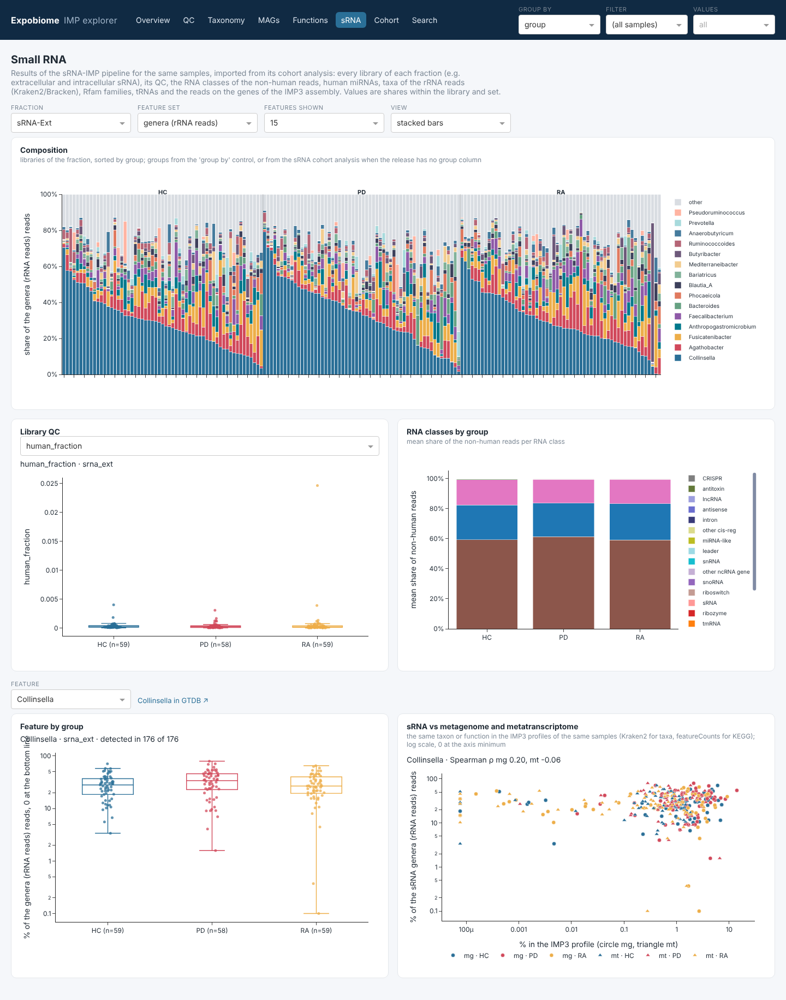

# sRNA layer

Studies with small-RNA sequencing of the same samples add the results of
[sRNA-IMP](https://github.com/genomeanalysislcsb/sRNA-IMP) as an optional layer. `imp-explorer srna` reads the
**Cohort folder of the sRNA-IMP cohort analysis** and writes `srna_*` tables into the release. Nothing is recomputed:
the tests and models are those of the sRNA-IMP cohort report, the per-library values those of its tables.

```bash
imp-explorer srna --data /path/to/release_v0.1 --srna-cohort /path/to/srna_outdir/Cohort
imp-explorer run --data /path/to/release_v0.1          # adds the sRNA page; sRNA layers on Cohort and Search
```

| option | default | meaning |
|---|---|---|
| `--srna-cohort` | – | the `Cohort` folder of sRNA-IMP (`tables/`, `stats/`) |
| `--block` | `site` | block column of the sRNA metadata (shown with the groups) |
| `--sig-q` | 0.1 | FDR threshold for the hit counts of the models |
| `--id-case`, `--id-regex`, `--id-map` | – | translate sRNA sample names to the ids of the release (as for `export`) |

The command reports how many sRNA samples it found in the release; with 0, translate the names. Re-running it
replaces the `srna_*` tables. Run it again after a new sRNA-IMP cohort analysis.

## What is imported

Per library, for each sRNA fraction (sRNA-IMP type, e.g. `sRNA-Ext`, `sRNA-Int`; key `srna_ext`, `srna_int`):

| table | content | from |
|---|---|---|
| `srna_samples` | fraction, group, block, QC verdict, in statistics, QC rules | `tables/cohort.sample_stats.tsv`, `cohort.qc_flags.tsv` |
| `srna_qc` | every library metric (long: `metric`, `value`) | `tables/cohort.sample_stats.tsv` |
| `srna_features` | reads and share per feature set: `mirna` (human miRNAs), `genus` / `family` / `species` (rRNA reads, Kraken2/Bracken), `rna_class`, `rfam_type`, `rfam_family`, `trna_aa`, `fn_kegg_*`, `fn_pfam`, `fn_cog` (sense reads on CDS of the IMP3 assembly) | `tables/cohort.<type>.<set>.counts.tsv` |

Cohort statistics, as layers `<fraction>.<set>` (e.g. `srna_ext.genus`, `srna_int.mirna`, `srna_ext.metrics`):

| table | content | from |
|---|---|---|
| `srna_tests` | Kruskal-Wallis across groups; each group vs the reference within blocks; the block contrast in the reference group | `stats/*.by_group.tsv`, `*.metrics_by_group.tsv`, `*.matched.<comparison>.<set>.tsv` |
| `srna_models`, `srna_models_overview` | adjusted models (OLS on CLR, HC3), term of interest = first term of the formula | `stats/*.model_M<n>.<set>.tsv`, `cohort.models.tsv` |
| `srna_permanova` | PERMANOVA per variable and per comparison (genus profiles) | `stats/*.permanova.tsv` |
| `srna_dispersion`, `srna_ordination` | dispersion, NMDS | `stats/cohort.heterogeneity.dispersion.tsv`, `*.nmds.tsv` |
| `srna_covariates` | covariate balance | `stats/cohort.covariates_by_group.tsv` |

Antisense sets (`fnas_*`, antisense index) are not imported. Comparison labels follow `imp-explorer cohort`
(`PD vs HC (Kassel)`, `HC: Berlin vs Kassel`).

## In the app



- **sRNA page**: composition of any feature set per library (stacked bars or [clustered heatmap](app.md#clustered-heatmaps)),
  library QC and RNA classes by group, one feature by group and **next to the metagenome and metatranscriptome** of
  the same samples (Kraken2 for taxa, featureCounts for KEGG; Spearman ρ). Groups come from the 'group by' control,
  or from the sRNA cohort analysis when the release has no group column.
- **Cohort page**: the sRNA layers appear next to the IMP3 layers in group comparisons, models and beta diversity.
  Models with the same number and formula in both analyses are listed once (`[IMP3 + sRNA]`), so one model can be
  compared across data types.
- **Search**: miRNAs and every sRNA feature are found; a taxon or KEGG term shows its sRNA shares next to Kraken2,
  mOTUs, MAGs and functions.

!!! note "Same analysis, same numbers"
    The sRNA statistics are taken from sRNA-IMP unchanged. For the same settings (groups, blocks, models: e.g. one
    [settings file](cohort.md#settings-file) for both), IMP3 and sRNA results come from the same statistics code.
